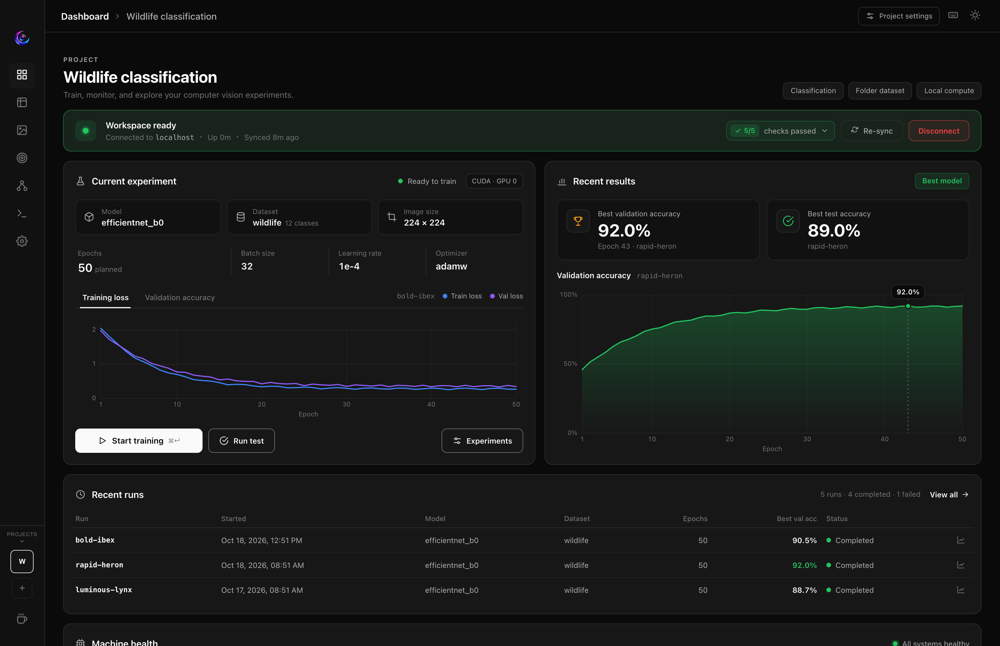
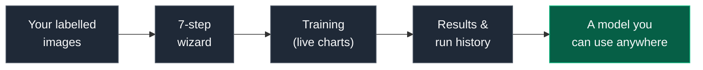
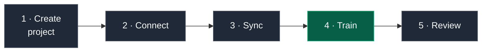
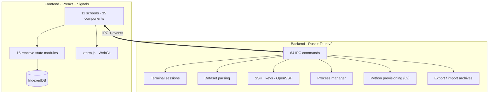

<div align="center">

<br>


### Train image models on your own computer.

**No cloud. No bills. No code.**

<br>

[](../../releases/latest)
[](LICENSE)
[](../../stargazers)
[](../../issues)
[](../../commits)


<br>



<br><br>

<table>
<tr>
<td align="center" width="33%">

**New to machine learning?**

[What you need](#what-you-need) → [Install](#install) → [Your first model](#your-first-model-in-10-minutes)

</td>
<td align="center" width="33%">

**Done this before?**

[Settings](#every-setting-in-one-place) · [Remote GPUs](#work-with-a-remote-gpu-server) · [Deploy](#export--deploy-a-model)

</td>
<td align="center" width="33%">

**Here to hack on it?**

[Architecture](#architecture) · [Build from source](#build-from-source)

</td>
</tr>
</table>

</div>

<br>

<details>
<summary><b> Table of contents</b></summary>

<br>

**Getting started**
- [What is NightFlow?](#what-is-nightflow)
- [What you need](#what-you-need)
- [Install](#install)
- [Your first model in 10 minutes](#your-first-model-in-10-minutes)
- [Prepare your dataset](#prepare-your-dataset)
- [Words you'll see](#words-youll-see)

**Using NightFlow**
- [Reading your results](#reading-your-results)
- [A tour of the app](#a-tour-of-the-app)
- [Every setting in one place](#every-setting-in-one-place)
- [Work with a remote GPU server](#work-with-a-remote-gpu-server)
- [Move a project to another computer](#move-a-project-to-another-computer)
- [Export & deploy a model](#export--deploy-a-model)
- [See what the model learned](#see-what-the-model-learned)

**Help**
- [Troubleshooting](#troubleshooting)
- [FAQ](#faq)

**For developers**
- [Architecture](#architecture)
- [Build from source](#build-from-source)
- [Contributing](#contributing)

</details>

---

## What is NightFlow?

NightFlow teaches a computer to recognise things in pictures, using **your** images on
**your** machine.

You give it a folder of labelled photos (say, `cat/` and `dog/`), pick what you want it
to learn, and press **Start Training**. NightFlow writes the configuration, runs the
training, draws live charts while it learns, and keeps a history of every attempt so
you can compare them.



<table>
<tr>
<td width="50%" valign="top">

#### If you've never trained a model

The wizard asks seven plain questions and picks sensible defaults for anything you
don't know. You never have to open a config file, write Python or use a terminal.

</td>
<td width="50%" valign="top">

#### If you do this for a living

Every default can be overridden: optimizer, scheduler, precision, gradient clipping,
augmentation, accelerator, GPU IDs. The YAML it writes is a plain
[AutoTimm](https://github.com/theja-vanka/AutoTimm) config you can read, diff and reuse.

</td>
</tr>
</table>

> [!NOTE]
> **Your data stays yours.** No account, no telemetry, no uploads. Projects and runs are
> stored inside the app on your computer, and your images never leave the disk they're on.

---

## What you need

| What | Why |
| :--- | :--- |
| **A Mac with Apple silicon, a Linux PC (x64), or a Windows 11 PC (x64, beta)** | To run the app. |
| **Some labelled images**: ideally 50+ per category to start | What the model learns from. [How to lay them out →](#prepare-your-dataset) |
| **An internet connection for the first setup** | NightFlow downloads its own Python 3.12 and training libraries once per project. |
| **A GPU (optional)** | Makes training much faster. NVIDIA (CUDA) and Apple silicon (Metal) are used automatically; a plain CPU works too, just slower. |

> [!TIP]
> **You don't need to install Python.** During the first **Sync**, NightFlow installs
> [uv](https://github.com/astral-sh/uv), uses it to fetch Python 3.12, and builds a
> private environment inside the project folder. Nothing on your system is changed.

---

## Install

<table>
<tr>
<td width="50%" valign="top">

### macOS & Linux

Open **Terminal** and paste:

```bash
curl -fsSL https://raw.githubusercontent.com/Noctillio-Ai/NightFlow/main/install.sh | bash
```

It picks the right build for your computer, checks it, and installs it.

On Linux you get the AppImage. For the Debian/Ubuntu package instead:

```bash
curl -fsSL https://raw.githubusercontent.com/Noctillio-Ai/NightFlow/main/install.sh | bash -s -- --deb
```

</td>
<td width="50%" valign="top">

### Homebrew (macOS)

```bash
brew tap noctillio-ai/nightflow \
  https://github.com/Noctillio-Ai/NightFlow
brew install --cask nightflow
```

<br>

### Windows 11 (beta)

Open **PowerShell** and paste:

```powershell
irm https://raw.githubusercontent.com/Noctillio-Ai/NightFlow/main/install.ps1 | iex
```

Needs Windows 11 (build 22000+) on an x64 PC.

</td>
</tr>
</table>

<details>
<summary><b>About Windows, Intel Macs and updates</b></summary>

<br>

- **Windows is in beta.** The installer isn't code-signed yet, so SmartScreen may warn
  about it; the script clears that warning for the one installer it downloads. Windows 10
  and earlier aren't supported. Please [report anything that breaks](../../issues).
- **Intel Macs aren't supported.** NightFlow ships for Apple silicon (M1 and later) only.
- **Updates are built in.** When a new version is out, an **Update** button appears in
  the app. It downloads the update, closes, installs, and reopens. If a training run is
  active it asks first, since updating closes the app. If the automatic update can't run,
  the button switches to **Download** and opens the release page. Re-running the install
  command above also updates you.

</details>

---

## Your first model in 10 minutes



### 1 · Create a project

On first launch, click **Create your first project** (later, use the **+** in the
sidebar). A seven-step wizard opens. Not sure what to pick? Use the right-hand column:

| Step | It asks |  If you're unsure, pick |
| :--- | :--- | :--- |
| **1 · Connection** | Train on this computer, or work on a remote server over SSH? | **This machine** |
| **2 · Name** | A project name and folder | Any name; the default folder (`~/.nightflow/projects/<name>/`) is fine |
| **3 · Task** | What should the model do? | **Classification** (one label per image) |
| **4 · Backbone** | How big a model? | **Edge**: small and fast, perfect for a first try |
| **5 · Dataset** | Where your images are and how they're organised | **Folder** ([see the layout](#prepare-your-dataset)) |
| **6 · Training settings** | Epochs, learning rate, batch size… | Leave everything blank; good defaults are used |
| **7 · Review** | Check everything | Click **Create project** |

> [!TIP]
> Already have a project exported from NightFlow (for example from another computer)?
> Click **Import a project** on the start screen or inside the wizard instead.
> [More on moving projects →](#move-a-project-to-another-computer)

### 2 · Connect

On the **Dashboard**, click **Connect**. For a project on this machine it's instant;
for a remote one it opens the SSH connection.

### 3 · Sync (don't skip this!)

Click **Sync**. The first time takes a few minutes. NightFlow:

1. creates the project folder,
2. installs uv and Python 3.12 if needed, and builds a private environment with AutoTimm,
3. checks your dataset paths exist and match the format you chose,
4. picks up any runs already in the project folder.

When it's done, the banner reads **Workspace ready** with something like
**5/5 checks passed**. A red banner opens itself and tells you which check failed.

> [!IMPORTANT]
> Until a project is **connected and synced**, the sidebar only shows Dashboard and
> Settings. The other screens appear once there's something to show.

### 4 · Train

Press **Start Training** (or <kbd>Ctrl</kbd>/<kbd>⌘</kbd> + <kbd>Enter</kbd>). Charts start
moving within a minute or so. Loss should go **down**, accuracy **up**.

### 5 · Review

Open **Experiments** to see the run, its best score, and its full history.
[How to read the results →](#reading-your-results)

**That's it: you've trained an image model.** Try a bigger backbone, more epochs, or
a different augmentation preset, then compare the runs side by side.

---

## Prepare your dataset

This is where most first attempts go wrong, so here's exactly what each format expects.

| Task | What the model learns | Formats |
| :--- | :--- | :--- |
| **Classification** | One label per image (*"this is a cat"*) | Folder · CSV |
| **Multi-label classification** | Several labels per image (*"beach, sunset"*) | CSV · JSONL |
| **Object detection** | Boxes around objects (*"a car here, a person there"*) | COCO JSON · CSV |
| **Semantic segmentation** | A class for every pixel (*"road, sky, building"*) | PNG masks · COCO · Cityscapes · VOC · CSV |
| **Instance segmentation** | A mask for each separate object | COCO JSON · CSV |

<details open>
<summary><b> Classification with folders: the easiest way to start</b></summary>

<br>

Split your images into `train/` and `val/` (and optionally `test/`), with one folder
per category inside each:

```
my_dataset/
├── train/
│   ├── cat/    img001.jpg  img002.jpg  …
│   ├── dog/    img087.jpg  img088.jpg  …
│   └── bird/   img142.jpg  img143.jpg  …
├── val/
│   ├── cat/  ├── dog/  └── bird/
└── test/        (optional, same layout)
```

Point NightFlow at `my_dataset/`. It finds the categories and counts the images for you.

> [!TIP]
> Keep `val/` and `test/` images out of `train/`, so the scores measure how the model
> does on pictures it has never seen. A rough 80 / 10 / 10 split is a good start.

</details>

<details>
<summary><b> Classification with a CSV file</b></summary>

<br>

One row per image. The column names are up to you; you tell NightFlow which is which
in the wizard's **CSV columns** fields:

```csv
image_path,label
images/img001.jpg,cat
images/img002.jpg,dog
```

Relative paths are resolved against the **image folder** you choose. Provide separate
`train` / `val` / `test` files (validation and test are optional).

</details>

<details>
<summary><b> Object detection (COCO JSON)</b></summary>

<br>

The standard COCO layout:

```
my_dataset/
├── annotations/
│   ├── instances_train.json
│   └── instances_val.json
├── train/   000001.jpg  …
└── val/     000002.jpg  …
```

The number of classes is read from the annotation files, so you don't type it in.

</details>

<details>
<summary><b> Segmentation datasets</b></summary>

<br>

For both segmentation tasks, the dataset folder is used to find images **and** masks.
In CSV mode each row maps an `image_path` to a `mask_path`; instance segmentation adds
a label and an instance ID per row.

</details>

> [!TIP]
> Open the **Dataset** screen before you train. It shows what NightFlow actually
> understood: images per category, which splits it found, and the images themselves.
> Five minutes here can save an hour of training on the wrong data.

<details>
<summary><b>How many images do I need?</b></summary>

<br>

There's no magic number, but as a rough guide for classification:

| Images per category | What to expect |
| :--- | :--- |
| **20–50** | Enough to see it working; results will be rough. |
| **100–500** | Good results for clearly different categories. |
| **1,000+** | Strong results, even for categories that look alike. |

Balanced categories (roughly the same number of images each) train better than lopsided
ones. Augmentation helps a lot with small datasets.

</details>

---

## Words you'll see

<details>
<summary><b>A plain-English glossary</b> (open if a term on screen is unfamiliar)</summary>

<br>

| Term | In plain English |
| :--- | :--- |
| **Epoch** | One full pass through all your training images. 10 epochs = the model sees each image 10 times. |
| **Batch size** | How many images the model looks at in one step. Bigger is faster but needs more memory. |
| **Learning rate** | How big a step the model takes when it corrects itself. Too high and it never settles; too low and it learns slowly. |
| **Backbone** | The pre-trained network your model starts from. *Edge* is small and fast; *Research* is huge and accurate. |
| **Training / validation / test set** | Images to learn from, images to check progress on during training, and images held back for a final, honest score. |
| **Loss** | How wrong the model currently is. Should go down. |
| **Accuracy** | The share of images it labels correctly. Should go up. |
| **mAP** | The detection version of accuracy: how well its boxes match the real ones. |
| **Overfitting** | Memorising the training images instead of learning the pattern: training accuracy keeps rising while validation accuracy stalls or drops. |
| **Augmentation** | Randomly flipping, cropping and recolouring images during training so the model sees more variety. |
| **Early stopping** | Stopping automatically when the model stops improving, to save time. |
| **Checkpoint** | A saved snapshot of the model during training. The "best" checkpoint is the one with the best validation score. |
| **Run** | One training attempt with one set of settings. NightFlow keeps every run so you can compare them. |

</details>

---

## Reading your results

<table>
<tr>
<td width="50%" valign="top">

### While it trains

- **Live charts:** loss and accuracy (or mAP) update every epoch
- **Dashboard at a glance:** readiness checks, the current run, best results and recent runs
- **Machine health:** CPU, memory, disk, and per-GPU load, VRAM and temperature (NVIDIA)
- **Training queue:** line up several runs back to back
- **A real terminal:** watch the raw output, in as many tabs as you like
- **Crash recovery:** if the app closes mid-run, it reattaches and replays the log

</td>
<td width="50%" valign="top">

### After it trains

- **Run history:** searchable, sortable, and filterable
- **Compare runs:** curves and settings side by side
- **Confusion matrix:** which categories get mixed up, for train, validation and test
- **Per-class metrics:** precision, recall and F1 for every category
- **Model viewer:** the network's architecture, via [Netron](https://netron.app)
- **Interpretation:** heat maps of what the model looked at

</td>
</tr>
</table>

> [!TIP]
> **What does "good" look like?** Training and validation loss both go down and level
> off. If training keeps improving but validation gets worse, the model is
> [overfitting](#words-youll-see): try more images, stronger augmentation, fewer
> epochs, or turn on early stopping.

---

## A tour of the app

| Screen | Shortcut | What it's for |
| :--- | :---: | :--- |
| **Dashboard** | <kbd>⌘</kbd> <kbd>1</kbd> | Connect, sync, start training, watch progress and machine health |
| **Experiments** | <kbd>⌘</kbd> <kbd>2</kbd> | Every run: search, compare, open details, delete |
| **Dataset** | <kbd>⌘</kbd> <kbd>3</kbd> | Browse your images and check what was parsed |
| **Interpretation** | <kbd>⌘</kbd> <kbd>4</kbd> | Heat maps of what a trained model pays attention to |
| **Model viewer** | <kbd>⌘</kbd> <kbd>5</kbd> | Explore the network architecture |
| **Terminal** | <kbd>⌘</kbd> <kbd>6</kbd> | A full terminal in the project, with tabs |
| **Settings** | <kbd>⌘</kbd> <kbd>7</kbd> | Everything about the project, plus SSH keys and import/export |

On Windows and Linux use <kbd>Ctrl</kbd> instead of <kbd>⌘</kbd>.

<details>
<summary><b>⌨ All keyboard shortcuts</b></summary>

<br>

| Keys | Action |
| :--- | :--- |
| <kbd>⌘</kbd>/<kbd>Ctrl</kbd> + <kbd>1</kbd> … <kbd>7</kbd> | Jump between screens |
| <kbd>⌘</kbd>/<kbd>Ctrl</kbd> + <kbd>Enter</kbd> | Start training |
| <kbd>⌘</kbd> + <kbd>K</kbd> | Show the shortcut list |
| <kbd>⌘</kbd>/<kbd>Ctrl</kbd> + <kbd>S</kbd> | Save changes in Settings |
| <kbd>⌘</kbd> + <kbd>T</kbd> (macOS) · <kbd>Ctrl</kbd> + <kbd>Shift</kbd> + <kbd>T</kbd> | New terminal tab |
| <kbd>Esc</kbd> | Close the open dialog |

<kbd>Ctrl</kbd> + <kbd>K</kbd> and <kbd>Ctrl</kbd> + <kbd>T</kbd> are left to the shell when
the terminal has focus, so its usual shortcuts keep working.

</details>

---

## Every setting in one place

Open **Settings** for any project. Each section remembers where you were, per project.
Leave a field blank and AutoTimm's default is used.

| Section | What's inside |
| :--- | :--- |
| **General** | Project name and folder, plus an overview of every section |
| **Connection** | This machine or remote (SSH), the SSH command, and which SSH key to use |
| **Dataset** | Format, folder or CSV/JSONL files, image folder, column names, number of classes |
| **Model** | Model tier, detection architecture or segmentation head, freeze backbone, `torch.compile` |
| **Hyperparameters** | Epochs, batch size, seed, learning rate, optimizer (AdamW/Adam/SGD), scheduler, weight decay, gradient clipping, early stopping |
| **Input & augmentation** | Image size and augmentation preset, with a live preview |
| **Hardware** | Accelerator (auto/CUDA/Metal/CPU), GPU IDs, precision (32 / 16-mixed / bf16-mixed), data-loader workers |
| **Appearance** | Dark or light theme, replay the app tour |
| **SSH keys** | Keys NightFlow may use, add existing ones or create new ones |
| **Import / export** | [Move the project](#move-a-project-to-another-computer) |
| **Danger zone** | Delete the project, or clear all app data |

> [!NOTE]
> Settings are **locked while a project is connected**, so nothing changes under a
> running job. Disconnect on the Dashboard to edit.

<details>
<summary><b> See the generated config</b> (nothing is hidden)</summary>

<br>

NightFlow writes a standard AutoTimm YAML, and every run keeps the exact config it used,
so a result from weeks ago can be reproduced exactly.

```yaml
seed_everything: 42
model:
  class_path: autotimm.tasks.ImageClassifier
  init_args:
    backbone: mobilenetv2_100
    num_classes: 3
    lr: 0.001
data:
  class_path: autotimm.data.ImageDataModule
  init_args:
    data_dir: /home/you/datasets/pets/
    batch_size: 32
trainer:
  max_epochs: 10
  accelerator: auto
  precision: 32-true
```

</details>

<details>
<summary><b> Preview augmentation before you train</b></summary>

<br>

Pick a preset (`default`, `light`, `autoaugment`, `randaugment` or `trivialaugment`),
press **Preview**, and drop in a sample image. You'll see six variants from the same
pipeline training uses, so you know what the policy does to your data before you commit.

</details>

---

## Work with a remote GPU server

Point a project at a server you reach over SSH (a lab machine, or a rented cloud GPU).

> [!IMPORTANT]
> **Training on the server is started from the terminal for now.** The **Start
> Training** button runs training on this computer only, and shows an error for remote
> projects. Everything else below works with the server today.

**1. Choose *Remote instance*** in the wizard (or **Settings → Connection**) and enter the
SSH command you'd normally type:

```bash
ssh ubuntu@203.0.113.10
```

**2. Pick an SSH key** (optional but recommended). In **Settings → SSH keys** you can:

- **Add existing keys** from `~/.ssh` or anywhere on disk; NightFlow shows each key's type
  and fingerprint and warns about problems like loose file permissions.
- **Create a new key** (Ed25519 or RSA 4096, with an optional passphrase). NightFlow then
  shows the public key and the exact `ssh-copy-id` command to install it on the server.

Choose the key under **Connection → SSH key**. NightFlow then offers the server **only**
that key, which avoids "Too many authentication failures" when you have several.

**3. Connect and Sync.** NightFlow installs uv, Python 3.12 and AutoTimm on the server,
and **Machine health** shows the server's CPU, memory, disk and GPUs.

**4. Train in a terminal tab.** Open the **Terminal** view; it's already connected to the
server. Run AutoTimm there with a config and data paths that exist on the server. Open
more tabs (<kbd>⌘</kbd> <kbd>T</kbd>, or <kbd>Ctrl</kbd> <kbd>Shift</kbd> <kbd>T</kbd>) to
watch logs or the GPU while it trains.

> [!TIP]
> NightFlow uses your system's own OpenSSH, so `~/.ssh/config` aliases, jump hosts and
> agent forwarding all work as usual. Keys with a passphrase need to be loaded into
> `ssh-agent` (`ssh-add`), because NightFlow connects without a terminal to ask.

---

## Move a project to another computer

**Settings → Import / export → Export…** packages a project in one of three sizes:

| Level | Contains | File | Typical size |
| :--- | :--- | :---: | :--- |
| **Lite** | Settings only: a template for a similar project | `.json` | KB |
| **Standard** | Settings + every run: metrics, notes, tags, test results | `.json` | KB – MB |
| **Full** | Standard + the run files: logs, checkpoints, exported models, and optionally the **dataset** | `.nightflow` | MB – GB |

- **Full** shows what it found before you export (*"2 trained models and 2 checkpoints"*),
  lets you choose which checkpoints to include (best + last, all, or none), and reports
  exactly what went into the archive. For remote projects, files are downloaded from the
  server over SSH.
- **Include dataset** (Full only) packs your images too; on import they go into the
  project folder and the dataset paths are updated automatically.
- **Include connection details** keeps or leaves out the SSH command and folder paths.
  Paths in your home folder are saved as `~/…`, so they still work for a different
  user name or operating system.

**To import:** use **Import a project** on the start screen, inside the new-project
wizard, or in **Settings → Import / export**. You'll see a preview, can create a new
project or replace the current one, and can point the dataset to wherever it lives on
the new computer (NightFlow checks the path exists).

> [!TIP]
> When you delete a project, NightFlow offers to **export it first**, so you always have
> a way back.

---

## Export & deploy a model

Turn a finished run into a file you can use in your own apps:

| Format | Best for |
| :--- | :--- |
| **TorchScript** (`.pt`) | PyTorch apps on CPU, CUDA or Apple Metal |
| **ONNX** (`.onnx`) | Almost anywhere: ONNX Runtime on CPU, CUDA, CoreML and more |
| **TensorRT** (`.engine`) | The fastest option on NVIDIA GPUs (needs one on the training machine) |
| **Hugging Face Hub** | Share it: push to a repo with a generated model card |

---

## See what the model learned

Six ways to visualise which parts of an image drove a prediction:

<table>
<tr>
<td width="33%" valign="top">

**GradCAM · GradCAM++**

Highlights the region behind the prediction. `++` handles several objects better.

</td>
<td width="33%" valign="top">

**Integrated Gradients · SmoothGrad**

Pixel-level detail. SmoothGrad reduces the noise.

</td>
<td width="33%" valign="top">

**Attention Rollout · Attention Flow**

Made for Vision Transformer models.

</td>
</tr>
</table>

---

## Troubleshooting

| Symptom | Fix |
| :--- | :--- |
| **The sidebar only shows Dashboard and Settings** | Connect, then **Sync**. The other screens appear once the project is ready. |
| **Settings fields are greyed out** | Settings lock while connected. Disconnect on the Dashboard to edit. |
| **Training fails right away** | Sync didn't finish. Re-run it and check the Python environment step in the sync log. |
| **"Managed training currently launches local processes only"** | The project is remote. Start training in a [terminal tab](#work-with-a-remote-gpu-server) on the server. |
| **"Dataset shows zero images"** | The path is wrong, or the layout doesn't match the chosen format. The **Dataset** screen shows what was parsed. |
| **Dataset path "not found" after moving computers** | Point it at the right folder in the import dialog or **Settings → Dataset**, or export with **Include dataset** next time. |
| **SSH: "Permission denied" or "Too many authentication failures"** | Pick the right key in **Settings → Connection → SSH key**, and make sure its public key is on the server. |
| **SSH key "permissions too open"** | Run the `chmod 600 …` command shown in **Settings → SSH keys**, then **Re-check**. |
| **"No augmented images generated"** | AutoTimm isn't in the project environment yet. Re-run **Sync**. |
| **TensorRT export is unavailable** | No NVIDIA GPU was found on the training machine. |

Still stuck? [Open an issue](../../issues) and attach the **sync log**; that's the
fastest way to a fix.

---

## FAQ

<details>
<summary><b>Do I need to know Python or machine learning?</b></summary>

<br>

No. The wizard and defaults cover a complete first run. The [glossary](#words-youll-see)
explains the terms you'll meet, and you can learn the knobs as you go.

</details>

<details>
<summary><b>Does it cost anything, or send my data anywhere?</b></summary>

<br>

It's free and open source (Apache 2.0). There's no account and no telemetry. The only
network traffic is what you ask for: downloading Python packages during Sync, SSH to
your own servers, update checks, and pushing to Hugging Face if you choose to.

</details>

<details>
<summary><b>Where are my projects stored?</b></summary>

<br>

Project settings and run history live in the app's local database. Training files
(logs, checkpoints, exported models) live in each project's folder, by default
`~/.nightflow/projects/<name>/`. It's a hidden folder; in Finder press
<kbd>⌘</kbd> <kbd>Shift</kbd> <kbd>.</kbd> to show it.

</details>

<details>
<summary><b>Can I use my own pre-trained backbone?</b></summary>

<br>

NightFlow offers curated tiers (Edge, Balanced, Cloud, Research) of
[timm](https://github.com/huggingface/pytorch-image-models) backbones that work well
for each task. Because the generated config is plain AutoTimm YAML, you can also take it
and run AutoTimm directly with any backbone you like.

</details>

<details>
<summary><b>Can NightFlow train on my remote GPU server?</b></summary>

<br>

It connects, sets up the environment, monitors the hardware and gives you terminal tabs
on the server, but the **Start Training** button only launches local runs for now.
Start remote training from a terminal tab. [Details →](#work-with-a-remote-gpu-server)

</details>

<details>
<summary><b>How do I update NightFlow?</b></summary>

<br>

Click **Update** when it appears in the app, or re-run the install command.

</details>

---

## Architecture

A [Tauri v2](https://v2.tauri.app) desktop app: a Preact front end and a Rust core
talking over IPC. No bundled browser engine and no Node runtime in the shipped app.



<details>
<summary><b>Why these choices</b></summary>

<br>

| Layer | Choice | Why |
| :--- | :--- | :--- |
| UI | Preact + Signals | Fine-grained updates, with no re-render of the page on every metric tick |
| Terminal | xterm.js + WebGL | Keeps up with heavy training output without dropping frames |
| Backend | Rust (2024 edition) | Reliable long-running process supervision and log tailing |
| Processes | portable-pty + Tokio | A real terminal, so progress bars render correctly |
| Storage | IndexedDB | Local-only by design |
| Environments | [uv](https://github.com/astral-sh/uv) | Fetches Python and installs packages quickly, without touching the system |
| Training | [AutoTimm](https://github.com/theja-vanka/AutoTimm) | timm backbones on PyTorch Lightning |

</details>

<details>
<summary><b>Where things live</b></summary>

<br>

```
src/
├── views/          11 screens (Dashboard, Experiments, Settings, Terminal, …)
├── components/     shared UI: wizard, dialogs, SSH keys, export/import, charts
│   ├── dashboard/  dashboard sections
│   ├── deploy/     model export and publishing
│   └── run/        run details
├── hooks/          shared hooks (terminal, system metrics, Escape to close)
├── state/          signal stores (projects, training, terminal tabs, SSH keys, transfer, …)
├── db/             IndexedDB access
└── utils/          config generation, model catalog, paths, export format

src-tauri/src/
├── training.rs        process supervision, log tailing, crash recovery
├── env.rs             uv + Python environment provisioning
├── fs.rs              dataset parsing and structure validation
├── runs.rs            run and metric parsing
├── exports.rs         TorchScript / ONNX / TensorRT export
├── interpretation.rs  attribution maps and augmentation preview
├── transfer.rs        project export/import archives
├── ssh.rs             remote commands, SSH key scan/inspect/create
├── pty.rs             terminal sessions
├── system.rs          CPU, memory and GPU metrics
├── synclog.rs         sync log streaming
└── updater.rs         in-app updates
```

</details>

---

## Build from source

```bash
git clone https://github.com/Noctillio-Ai/NightFlow.git
cd NightFlow
npm install --legacy-peer-deps
npx tauri dev
```

The first run compiles the Rust backend and takes a few minutes; after that, rebuilds
are incremental.

<details>
<summary><b>Prerequisites</b></summary>

<br>

| Requirement | Version |
| :--- | :--- |
| **Node.js** | 22+ |
| **Rust** | Stable (2024 edition) |

**Debian / Ubuntu:** install the Tauri system libraries first:

```bash
sudo apt-get update && sudo apt-get install -y \
  libwebkit2gtk-4.1-dev libappindicator3-dev librsvg2-dev \
  patchelf libgtk-3-dev libsoup-3.0-dev libjavascriptcoregtk-4.1-dev
```

**Windows 11:** install the Microsoft C++ Build Tools ("Desktop development with C++").
WebView2 ships with Windows 11.

</details>

<details>
<summary><b>Everyday commands</b></summary>

<br>

| Task | Command |
| :--- | :--- |
| Full app with hot reload | `npx tauri dev` |
| Front end only | `npm run dev` |
| Lint | `npm run lint` |
| JavaScript tests | `npm test` |
| Rust tests + lint | `cd src-tauri && cargo test && cargo clippy` |
| Build installers | `npx tauri build` |

`npm test` checks that the YAML NightFlow generates is accepted by AutoTimm across every
task, format and accelerator combination; `tests/check_autotimm_config.py` validates the
same configs against a real AutoTimm install.

</details>

<details>
<summary><b>Updating the bundled Netron viewer</b></summary>

<br>

The Model viewer runs a copy of [Netron](https://github.com/lutzroeder/netron) shipped in
`public/netron/`. It's never fetched at runtime, so it only changes when you update it.
The installed version is in `public/netron/VERSION`.

1. **Check for a newer release** (changes nothing):

   ```bash
   scripts/update-netron.sh --check
   ```

2. **Update** to the latest release, or pass a version to pin one:

   ```bash
   scripts/update-netron.sh          # latest
   scripts/update-netron.sh 9.3.2    # a specific version
   ```

   The script downloads Netron's release from PyPI, verifies its SHA-256, and replaces
   `public/netron/`, removing files the new release no longer ships.

3. **Review** with `git status --short public/netron`.

4. **Test in the app:** run `npx tauri dev`, open the **Model viewer**, load a finished
   run, and check that the graph renders, zooms, and shows a layer's properties.

5. **Commit `public/netron/` on its own** (e.g. `chore: update Netron to 9.4.0`) so a
   bad update is easy to revert, or re-run the script with the previous version.

Don't edit files inside `public/netron/`; the next update replaces the whole folder. The
script needs `curl`, `unzip` and `python3` (macOS or Linux; on Windows use WSL or Git Bash).

</details>

---

## Contributing

Issues and pull requests are very welcome.

1. **Fork** the repository.
2. **Branch:** `git checkout -b feat/your-feature`
3. **Keep it green:** `npm run lint`, `npm test` and `cargo clippy` should all pass.
4. **Open a pull request.** It can merge into `main` once **Lint** and the
**macOS, Windows and Linux** builds pass.

Full documentation: **[noctillio-ai.github.io/NightFlow](https://noctillio-ai.github.io/NightFlow/)**

---

## License

[Apache 2.0](LICENSE)

<div align="center">
<br>

**Built by [Krishnatheja Vanka](https://github.com/theja-vanka)**

If NightFlow saved you time or cloud bills, a coffee helps keep it going.

<a href="https://www.buymeacoffee.com/theja.vanka" target="_blank"></a>

<br><br>
</div>
